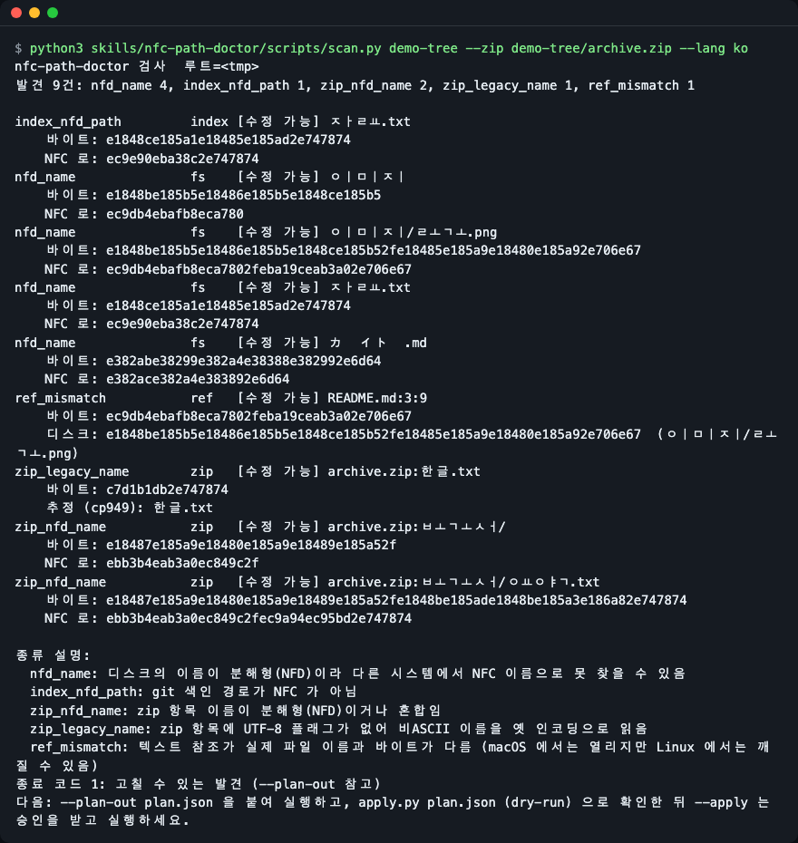
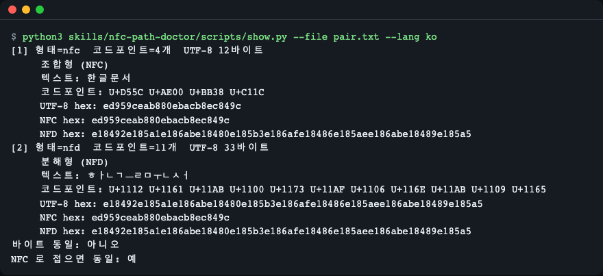
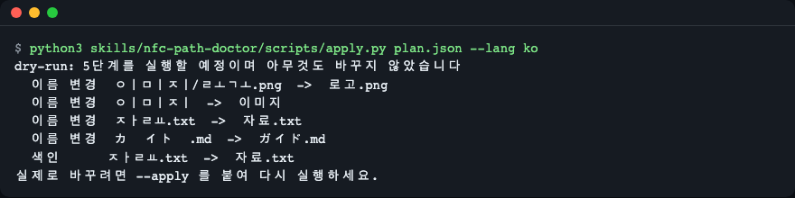
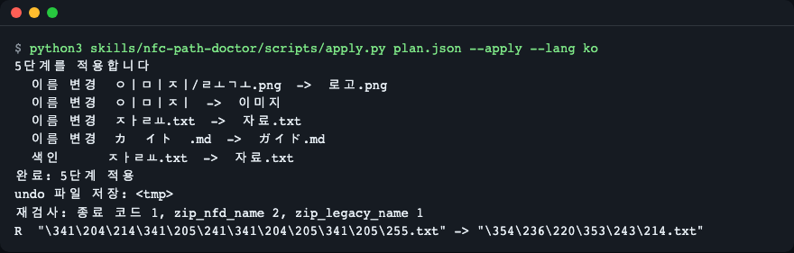
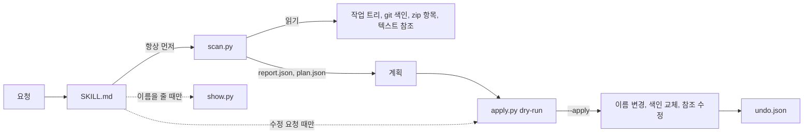

# nfc-path-doctor

[English](README.md) | **한국어**

파일·폴더 이름의 유니코드 정규화(NFC·NFD) 불일치를 찾아 안전하게 고치는 에이전트 스킬입니다. "분명히 있는 파일을 못 찾는다", "같은 한글·일본어·악센트 파일이 git 에 두 번 보인다" 같은 상황에서, 작업 트리·git 색인·zip 파일·텍스트 참조에 저장된 이름의 실제 바이트를 비교하고 되돌리기 파일이 딸린 dry-run 이름 변경 계획을 만듭니다.


*데모 폴더에 `scan.py` 실행: 발견마다 이름의 실제 바이트와 NFC 로 바꾼 값이 나옵니다. 스크린샷은 zip 위치를 `archive.zip:` 으로 줄여 보여 줍니다. 직접 실행하면 압축 파일의 전체 경로가 나오고, 한국어 로캘이 아니면 영어로 나옵니다(`--lang ko` 로 한국어 고정).*

## 무엇을 하나

- **눈이 아니라 바이트를 읽습니다.** `show.py` 는 이름의 형태(`nfc`, `nfd`, `ascii`, `neutral`, `mixed`, `undecodable`)·코드포인트·UTF-8 hex 를 보여 주고, 두 이름이 바이트까지 같은지 NFC 로 접어야 같은지 알려 줍니다.
- **네 곳을 비교합니다.** `scan.py` 는 작업 트리, git 색인, zip 항목(수정하지 않음), 경로처럼 생긴 텍스트 참조를 검사하고, 실제 파일과 바이트가 다른 링크는 `파일:줄:열` 로 알려 줍니다.
- **위험한 이름 변경은 막습니다.** NFC·NFD 두 이름이 같이 있으면 종료 코드 3 으로 끝내고, 계획에서도 그 경로는 건드리지 않은 채 사람 결정에 맡깁니다.
- **먼저 dry-run 으로 고칩니다.** `apply.py` 는 기본으로 단계만 보여 주고 아무것도 바꾸지 않습니다. `--apply` 를 주면 깊은 이름부터 바꾸고, git 설정은 건드리지 않은 채 색인 항목을 교체하고, 참조를 고치고, 실패하면 되돌리고, `undo.json` 을 남깁니다.
- **영어·한국어 출력.** `--lang en|ko` 또는 `NFC_PATH_DOCTOR_LANG`. JSON 키는 언어와 무관하게 같습니다.

Python 3.10+ 표준 라이브러리만 씁니다. 네트워크 접근이 없습니다. `git` 은 선택(색인 검사에만 필요)입니다.

## 잡아내는 증상

- Finder 에서는 보이는 파일을 `ls`, `grep`, 에이전트의 파일 도구가 "없다"고 합니다.
- `*보고서*` 같은 glob 이 파일이 있는데도 아무것도 찾지 못합니다.
- git 이 같은 한글·일본어·악센트 파일을 두 번(추적됨 하나, untracked 하나) 보여 줍니다.
- 맥에서 커밋한 파일이 다른 컴퓨터에서 자소가 분리된(자음·모음으로 쪼개진) 이름으로 보입니다.
- 압축을 푼 뒤 zip 안의 파일 이름이 깨져 보이거나 윈도우에서 깨집니다.
- Markdown 링크나 코드 속 경로가 내 맥에서는 되는데 Linux 나 GitHub 에서는 "없음"으로 나옵니다.

모두 한 가지 사실에서 나옵니다. 두 이름이 똑같이 보여도 바이트는 다를 수 있습니다([배경](#배경) 참고).

## 설치

**Claude Code**

```
/plugin marketplace add LeeGyeongPil/nfc-path-doctor
/plugin install nfc-path-doctor@nfc-path-doctor-skill
```

**다른 에이전트(Agent Skills 표준)** — `skills/nfc-path-doctor` 를 에이전트의 스킬 폴더(예: 프로젝트의 `.agents/skills/`)에 복사합니다. Codex CLI 도 그중 하나이며 아래 작업 검증을 통과했습니다.

에이전트 없이 스크립트만 써 보려면 저장소를 받아 직접 실행합니다.

```
git clone https://github.com/LeeGyeongPil/nfc-path-doctor.git
cd nfc-path-doctor
python3 tools/make_demo.py demo-tree
python3 skills/nfc-path-doctor/scripts/scan.py demo-tree --zip demo-tree/archive.zip
```

`tools/make_demo.py` 는 실행할 때 이름을 자소 분리(NFD)해서 작은 폴더, git 저장소, zip 파일을 만듭니다. 마지막 명령이 위 검사 결과를 출력합니다(종료 코드 1 은 고칠 수 있는 발견이 있다는 뜻).

## 사용법

평범한 말로 요청하면 됩니다. 에이전트가 이 스킬을 쓰게 되는 요청 예시입니다.

- "Finder 에서는 한글 이름 메모 파일이 보이는데 `ls | grep` 으로 이름을 찾으면 아무것도 안 나와요. 파일은 분명히 있어요." (영어 요청 예: "I can see my Korean-named notes file in Finder, but `ls | grep` on the name finds nothing.")
- "맥에서 지난주에 커밋한 한글 이름 텍스트 파일이 git status 에서 untracked 로 나와요. 왜 git 이 잊어버렸을까요?"
- "압축을 풀었더니 한글 파일 이름이 자음 모음으로 쪼개져 보여요. 원인을 좀 찾아 주세요."

요청 뒤에서 에이전트는 직접 실행해 볼 수 있는 것과 같은 명령을 돌립니다. `SKILL.md` 의 진입점은 하나입니다. 에이전트는 항상 `scan.py` 를 먼저 돌리고, 나머지 두 스크립트는 두 경우에만 씁니다(비교할 이름을 줄 때, 수정을 요청할 때).

**1. 검사(항상 먼저).** `--exit-zero` 는 프로세스 종료 코드를 0 으로 만들어 에이전트가 발견을 오류로 오해하지 않게 합니다. 결과 코드는 `report.json` 의 `exit_code` 에 들어 있습니다. `--zip FILE.zip` 을 더하면 압축을 풀지 않고 안을 들여다봅니다.

```
python3 skills/nfc-path-doctor/scripts/scan.py demo-tree --zip demo-tree/archive.zip --exit-zero --out report.json --plan-out plan.json
```

검사 표는 맨 위 스크린샷입니다. `report.json` 에는 모든 발견(`summary`, `path_hex`, `nfc_hex`, 깨진 링크의 `location`)이 있고, `plan.json` 은 dry-run 이름 변경 계획입니다. 다른 옵션(`--no-git`, `--exclude`, `--json` 등)은 [`references/formats.md`](skills/nfc-path-doctor/references/formats.md) 에 있습니다.

**2. 이름 두 개 비교(이름을 줄 때만).** 아래 두 줄은 똑같이 보이지만 바이트가 다릅니다. `pair.txt`(한 단어, 1행 NFC, 2행 NFD)를 만들어 비교합니다.

```
python3 -c "import unicodedata as u; s='한글문서'; open('pair.txt','w').write(u.normalize('NFC',s)+'\n'+u.normalize('NFD',s)+'\n')"
python3 skills/nfc-path-doctor/scripts/show.py --file pair.txt
```


*`show.py --file pair.txt`: `바이트 동일: 아니오`, `NFC 로 접으면 동일: 예`.*

**3. 고칠 계획 확인(dry-run, 수정을 요청할 때만).** `apply.py` 는 1단계의 `plan.json` 을 읽고 아무것도 바꾸지 않습니다.

```
python3 skills/nfc-path-doctor/scripts/apply.py plan.json
```


*dry-run: 5단계를 실행할 예정이며 아무것도 바꾸지 않았습니다.*

**4. 적용하고, 필요하면 되돌리기.**

```
python3 skills/nfc-path-doctor/scripts/apply.py plan.json --apply
python3 skills/nfc-path-doctor/scripts/apply.py --undo undo.json --apply
```


*`--apply` 뒤 `git status --porcelain` 은 삭제 + untracked 가 아니라 NFC 경로로의 이름 변경(`R`)으로 보입니다. 데모 저장소는 `자료.txt` 하나만 추적하므로 직접 실행하면 나머지 데모 파일이 untracked(`??`)로 함께 나옵니다. 스크린샷은 추적 중인 줄만 보여 줍니다. zip 은 검사만 하므로 재검사에는 여전히 남습니다(`재검사: 종료 코드 1, zip_nfd_name 2, zip_legacy_name 1`).*

`scan.py` 종료 코드: `0` 깨끗함, `1` 고칠 수 있는 발견, `3` 사람 결정 필요, `2` 입력 오류. `apply.py`: `0` 정상(dry-run 포함), `1` 계획이 오래되어 아무것도 바꾸지 않음, `2` 입력 오류, `4` 한 단계가 실패해 끝난 단계를 되돌림. 필드 설명은 [`skills/nfc-path-doctor/references/formats.md`](skills/nfc-path-doctor/references/formats.md) 에 있습니다.

## 검증된 동작

<!-- skill-eval:start -->
| 확인 | 결과 |
|---|---|
| 필요할 때 불림 | 11/12 |
| 필요 없을 때 안 불림 | 12/12 |
| 스킬로 푼 작업 | 5/5 |
| 스킬 없이 푼 작업(기준선) | 0/5 |
| 평균 점수 차이(Δ) | +0.72 |
| 가짜 스크립트를 잡아낸 비율 | 5/5 |
| Codex CLI | 작업 5/5 통과 · 확인됨 |

Claude Code 2.1.322 · sonnet · 케이스마다 3회 · 2026-11-19 측정 · codex-cli 0.154.0
<!-- skill-eval:end -->

## 동작 원리



- `SKILL.md` 의 진입점은 하나입니다. `scan.py` 를 먼저 돌리고 그 출력과 `report.json` 으로 답합니다. 또한 하면 안 되는 일(이름 다시 타이핑, git 설정 변경, NFD→NFC 에 `git mv` 사용)을 에이전트에게 알려 줍니다.
- `scan.py` 는 읽기만 합니다. 폴더 목록, `git` 으로 읽는 색인, 읽기 전용으로 여는 zip, 텍스트 파일만 봅니다.
- `apply.py` 는 쓰는 유일한 스크립트이며 검사한 폴더 안에서만 씁니다. 먼저 계획이 오래되지 않았는지 확인합니다.
- 내 컴퓨터 밖으로 나가는 것이 없습니다. 네트워크 접근이 없고, 가리킨 폴더 안 파일을 읽고 이름을 바꾸는 것 외 추가 권한이 필요 없습니다.

## 왜 전부 한꺼번에 바꾸지 않나

"모든 이름을 NFC 로 일괄 변환"은 위험합니다.

- Linux(ext4)와 zip 파일·git 색인 안에서는 한 이름의 NFC 형과 NFD 형이 서로 다른 두 파일로 함께 있을 수 있습니다. 일괄 변환은 한쪽이 다른 쪽을 덮어쓰게 만듭니다. 검사는 이런 쌍을 찾아 종료 코드 3 으로 끝내고 사람이 정하도록 남겨 둡니다.
- macOS(APFS)에서는 조회할 때 두 형태가 같은 파일이라, "NFC 이름이 이미 있나?"가 이름을 바꾸려는 바로 그 파일에 대해 "있음"으로 답합니다. 계획은 경로 조회가 아니라 폴더 목록으로 확인합니다.
- `git mv` 는 인자를 합성형으로 바꿔 버려 NFD→NFC 이름 변경을 표현할 수 없습니다. `apply.py` 는 색인 항목을 직접 교체하고 git 설정은 바꾸지 않습니다.

## 배경

- **NFC** 는 글자를 합성합니다. 한글 음절은 코드포인트 하나, `é` 는 U+00E9 입니다.
- **NFD** 는 글자를 분해합니다. 음절은 자모 두세 개가 되고, `é` 는 `e` 와 U+0301 이 됩니다.
- 예: 한글문서 라는 단어는 NFC 에서 4 코드포인트, NFD 에서 11 코드포인트입니다. 똑같이 보이지만 바이트가 다릅니다.

| 파일 시스템 | 두 형태를 다루는 방식 |
|---|---|
| APFS(macOS 기본) | 준 바이트를 그대로 저장하고 정규화를 무시하고 비교: 이름 하나, 파일 하나 |
| HFS+(옛 macOS) | NFD 로 강제 |
| ext4, XFS(Linux) | 원시 바이트: NFC 와 NFD 는 서로 다른 두 파일 |
| NTFS(Windows) | 원시 UTF-16, 이 점에서는 Linux 와 같음. 이 스킬은 확인하지 않음 |

macOS 의 git(`core.precomposeunicode`)과 zip 의 UTF-8 플래그(11번 비트, `0x800`)는 형태와 인코딩이 어긋날 수 있는 두 곳을 더합니다. 자세한 내용, 실측 동작, 확인 날짜가 붙은 출처는 [`skills/nfc-path-doctor/references/background.md`](skills/nfc-path-doctor/references/background.md)(영어)에 있습니다.

## 언제 쓰나

잘 맞는 경우: macOS 의 에이전트가 눈에 보이는 파일을 없다고 하는 경우, 비ASCII 이름 검색이 빗나가는 경우, zip 이나 저장소가 macOS 와 Linux 사이를 오가는 경우, 링크가 내 컴퓨터에서는 되는데 GitHub 에서 깨지는 경우.

맞지 않는 경우: 텍스트 인코딩 변환, 파일 내용 정규화, 대소문자만 바꾸는 이름 변경.

## 대안

폴더 하나를 손으로 바꾸고 싶고 안전하다는 것을 이미 안다면 아래 도구가 있습니다. 각각 무엇을 지원하는지는 해당 문서를 확인하세요.

- [nfd2nfc](https://github.com/elgar328/nfd2nfc)
- [convmv](https://manpages.debian.org/testing/convmv/convmv.1.en.html)
- [normalize-unicode-filename](https://github.com/mixcode/normalize-unicode-filename)
- [mac2win-zip](https://github.com/Wordbe/mac2win-zip)

이 스킬이 더하는 것은 에이전트에게 필요한 진단 단계입니다. 작업 트리·git 색인·zip 항목·텍스트 참조를 한 번에 대조하고, 충돌을 막고, undo 파일이 딸린 dry-run 계획을 만듭니다.

## 한계

- NFC 만 지원합니다. NFKC·NFKD 는 이름 자체를 바꾸므로 쓰지 않습니다.
- zip 은 검사만 하고 다시 쓰지 않습니다. 이름을 고친 뒤 직접 다시 압축하세요.
- git 히스토리는 다시 쓰지 않습니다. 현재 색인만 바꿉니다.
- Windows 는 확인하지 않았습니다. Linux 동작(NFC·NFD 가 나란히 존재)은 macOS 에서 바이트를 그대로 보존하는 파일 시스템 모의 테스트로만 확인했습니다. Linux 전용 테스트는 Linux 에서만 실행되는 조건부 테스트이며, Linux 컨테이너나 CI 에서는 아직 돌려 보지 못했습니다.
- 퍼센트 인코딩 URL·문장 속 단어는 참조로 풀지 않습니다.
- HFS+ 는 이름을 분해형으로 유지하므로 NFC 로 바꾸는 이름 변경이 실패해 되돌려집니다.
- 스크립트가 쓰지 않은 기존 JSON 파일은 덮어쓰지 않고 멈춥니다(`error: refusing to overwrite ...`, 종료 코드 2). 다른 `--out` 이름을 고르세요.
- `.git/config` 를 막는 샌드박스에서는 저장소 zip 검사가 거기서 멈출 수 있습니다. `--no-git` 을 쓰거나 샌드박스 밖에서 압축을 푸세요.

## 언어

출력은 영어 또는 한국어이고 JSON 키는 바뀌지 않습니다. `--lang en|ko` 로 고르거나 `NFC_PATH_DOCTOR_LANG` 을 설정합니다. 우선순위: `--lang`, `NFC_PATH_DOCTOR_LANG`, `LC_ALL`, `LC_MESSAGES`, `LANG`. 한국어가 아니면 영어로 나옵니다.

```
NFC_PATH_DOCTOR_LANG=ko python3 skills/nfc-path-doctor/scripts/scan.py demo-tree
```

## 개발

```
uv sync && uv run pytest
```

`evals/` 폴더에 평가 세트가 있습니다. 발동 프롬프트(한국어 포함), 발동하면 안 되는 비슷한 프롬프트, `python3 evals/fixtures/build.py` 로 만드는 픽스처 압축 파일이 딸린 작업 케이스입니다. `claude plugin eval` 로 직접 돌려 볼 수 있습니다.

## 라이선스

MIT
