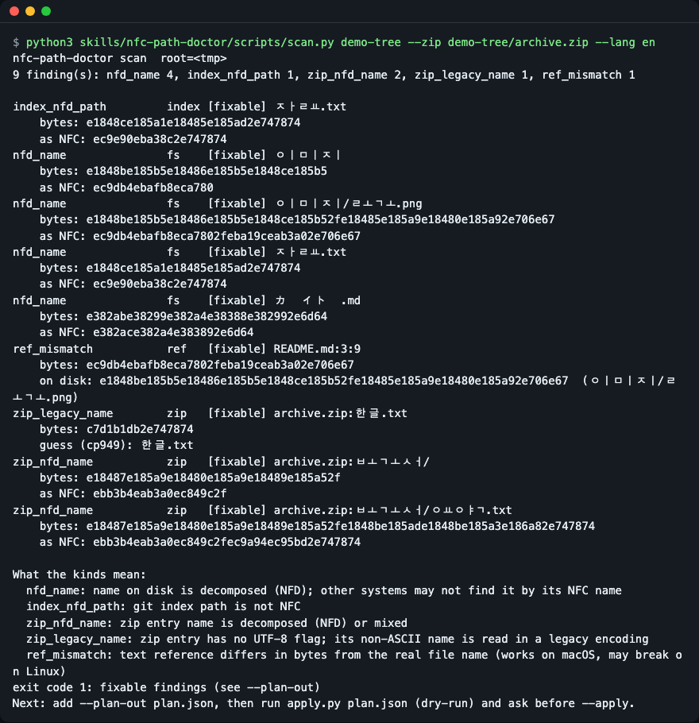
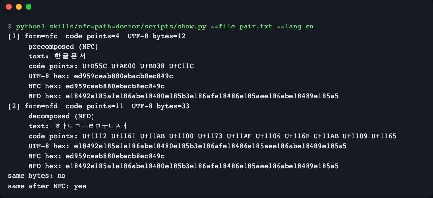
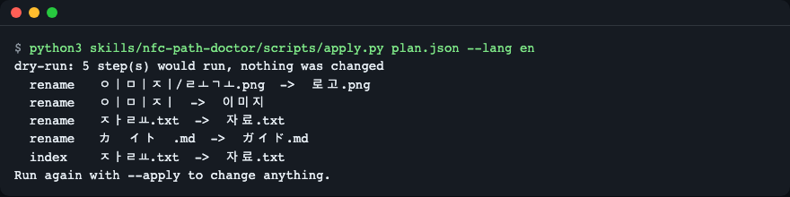
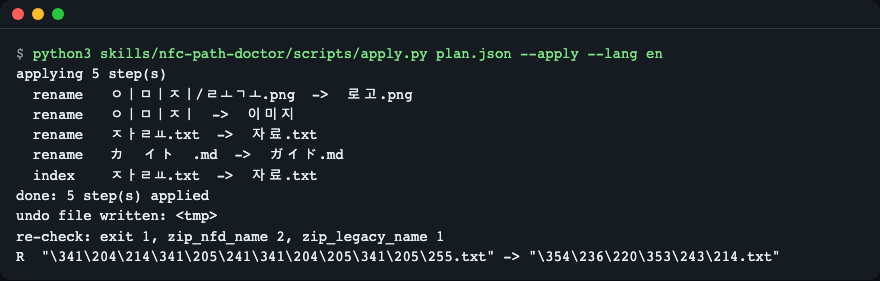
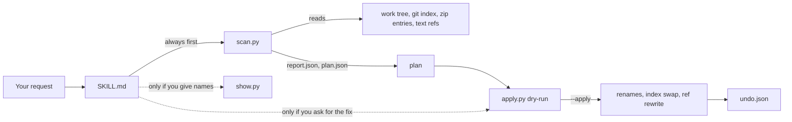

# nfc-path-doctor

**English** | [한국어](README.ko.md)

An agent skill that finds and fixes Unicode normalization (NFC vs NFD) mismatches in file and folder names. When a file "clearly exists" but is not found, or git shows the same Korean, Japanese or accented file twice, the skill compares the real bytes of names in the work tree, the git index, zip archives and text references, then writes a dry-run rename plan with an undo file.


*`scan.py` on the demo folder: each finding shows the real bytes of the name and what it would be as NFC. The screenshot was taken with `--lang en` and zip locations shortened to `archive.zip:` and the scanned folder shown as `<tmp>`; your run prints the full paths, and Korean output on a Korean locale (add `--lang en` for English).*

## What it does

- **Reads bytes, not looks.** `show.py` prints the form (`nfc`, `nfd`, `ascii`, `neutral`, `mixed`, `undecodable`), code points and UTF-8 hex of any name, and says whether two names are the same bytes or only the same after NFC.
- **Compares four places.** `scan.py` checks the work tree, the git index, zip entries (never modified) and path-like text references, and reports `file:line:column` for a link whose bytes differ from the real file.
- **Blocks dangerous renames.** If NFC and NFD copies of a name both exist, the scan exits with code 3 and the plan leaves them untouched for a human to decide.
- **Fixes with a dry-run first.** `apply.py` lists the steps and changes nothing by default. With `--apply` it renames deepest names first, replaces git index entries without touching git config, rewrites references, rolls back on failure and writes `undo.json`.
- **English and Korean output.** `--lang en|ko` or `NFC_PATH_DOCTOR_LANG`. JSON keys never change.

Python 3.10+ standard library only. No network access. `git` is optional (index check only).

## Symptoms it catches

- A file you can see in Finder is "not found" by `ls`, `grep` or an agent's file tool.
- A glob such as `*보고서*` matches nothing, although the file is there.
- git lists the same Korean, Japanese or accented file twice: once tracked, once untracked.
- A file you committed on a Mac shows up with a decomposed name (split into consonants and vowels) on another machine.
- File names inside a zip look broken after unpacking, or break on Windows.
- A Markdown link or path in code works on your Mac but returns "not found" on Linux or on GitHub.

All of these come from one fact: two names can look identical and still be different bytes (see [Background](#background)).

## Install

**Claude Code**

```
/plugin marketplace add LeeGyeongPil/nfc-path-doctor
/plugin install nfc-path-doctor@nfc-path-doctor-skill
```

**Other agents (Agent Skills standard)** — copy `skills/nfc-path-doctor` into the agent's skills folder (for example `.agents/skills/` in a project).

**Quick start without an agent** — clone the repository and run the scripts directly:

```
git clone https://github.com/LeeGyeongPil/nfc-path-doctor.git
cd nfc-path-doctor
python3 tools/make_demo.py demo-tree
python3 skills/nfc-path-doctor/scripts/scan.py demo-tree --zip demo-tree/archive.zip
```

`tools/make_demo.py` builds a small folder whose names are decomposed (NFD) at run time, plus a git repository and a zip file. The last command prints the scan shown above (exit code 1 means fixable findings).

## Use it

Ask in plain words. These are the kinds of requests that make the agent use the skill:

- "I can see my Korean-named notes file in Finder, but `ls | grep` on the name finds nothing. The file is definitely there."
- "git status says my Korean-named text file is untracked even though I committed it last week on my Mac."
- "압축을 풀었더니 한글 파일 이름이 자음 모음으로 쪼개져 보여요. 원인을 좀 찾아 주세요." (After extracting, Korean file names show split into consonants and vowels. Please find the cause.)

Behind the request the agent runs the same commands you can run yourself. `SKILL.md` has a single entry point: the agent always runs `scan.py` first, and uses the other two scripts only in two cases (you give names to compare, or you ask for the fix).

**1. Scan (always first).** `--exit-zero` makes the process exit with 0 so an agent does not treat findings as a crash; the result code is stored in `report.json` as `exit_code`. Add `--zip FILE.zip` to look inside an archive without unpacking it.

```
python3 skills/nfc-path-doctor/scripts/scan.py demo-tree --zip demo-tree/archive.zip --exit-zero --out report.json --plan-out plan.json
```

The scan table is the screenshot at the top. `report.json` holds every finding (`summary`, `path_hex`, `nfc_hex`, `location` of a broken link); `plan.json` is the dry-run rename plan. Other options (`--no-git`, `--exclude`, `--json`, ...) are listed in [`references/formats.md`](skills/nfc-path-doctor/references/formats.md).

**2. Compare two names (only if you give names).** The two lines below look identical, but are different bytes. Make `pair.txt` (one word, NFC on line 1, NFD on line 2) and compare:

```
python3 -c "import unicodedata as u; s='한글문서'; open('pair.txt','w').write(u.normalize('NFC',s)+'\n'+u.normalize('NFD',s)+'\n')"
python3 skills/nfc-path-doctor/scripts/show.py --file pair.txt
```


*`show.py --file pair.txt`: `same bytes: no`, `same after NFC: yes`.*

**3. Plan the fix (dry-run, only if you ask for the fix).** `apply.py` reads the `plan.json` from step 1 and changes nothing:

```
python3 skills/nfc-path-doctor/scripts/apply.py plan.json
```


*Dry-run: 5 steps would run, nothing was changed.*

**4. Apply, then undo if needed.**

```
python3 skills/nfc-path-doctor/scripts/apply.py plan.json --apply
python3 skills/nfc-path-doctor/scripts/apply.py --undo undo.json --apply
```


*After `--apply`, `git status --porcelain` shows a rename (`R`) to the NFC path, not a deleted and an untracked file. Only `자료.txt` is tracked in the demo repo, so your `git status` also lists the other demo files as untracked (`??`); the screenshot shows the tracked line only, and the undo file path is shortened to `<tmp>`. Zip files are only inspected, so the re-check still reports them (`re-check: exit 1, zip_nfd_name 2, zip_legacy_name 1`).*

`undo.json` is written next to the plan. If that file still holds the undo record of an earlier `--apply` that has not been reverted (for example a second plan from the same folder), `apply.py` exits `2` before changing anything. Pass `--undo-out other.json`, run `--undo` first, or move the file away.

Exit codes of `scan.py`: `0` clean, `1` fixable findings, `3` a human decision is needed, `2` input error. `apply.py`: `0` ok (dry-run included), `1` plan is stale and nothing changed, `2` input error, `4` a step failed and finished steps were rolled back. Field details are in [`skills/nfc-path-doctor/references/formats.md`](skills/nfc-path-doctor/references/formats.md).

## Verified behavior

<!-- skill-eval:start -->
| Check | Result |
|---|---|
| Triggers when it should | 11/12 |
| Stays quiet when it should not | 12/12 |
| Tasks solved with the skill | 5/5 |
| Tasks solved without it (baseline) | 0/5 |
| Mean score gain (Δ) | +0.70 |
| Tasks that catch a broken script | 5/5 |
| Codex CLI | not verified |

Measured 2026-11-20 with Claude Code 2.1.322 · sonnet · 3 runs per case · codex-cli 0.154.0
<!-- skill-eval:end -->

## How it works



- `SKILL.md` has one entry point: run `scan.py` first, then answer from its printed output (it ends with a `Done:` line that says whether the table is the complete result); `report.json` holds the same findings as JSON, and is read only when the table is cut off at `--max-rows` (default 200). It also tells the agent what never to do (retype names, change git config, use `git mv` for NFD to NFC).
- `scan.py` only reads. It lists directories, reads the git index through `git`, opens zip files read-only and reads text files.
- `apply.py` is the only script that writes, and only inside the scanned folder. It checks that the plan is not stale first.
- Nothing leaves your machine: there is no network access and no extra permission beyond reading and renaming files in the folder you point at.

## Why not just rename everything?

A bulk "convert every name to NFC" is risky:

- On Linux (ext4) and inside zip files and git indexes, the NFC and NFD form of a name can both exist as two different files. A bulk rename would overwrite one with the other. The scan finds these pairs, exits with code 3 and leaves them for a human decision.
- On macOS (APFS) the two forms are the same file for lookups, so "does the NFC name already exist?" answers yes for the file you are about to rename. The plan checks the folder listing, not a path lookup.
- `git mv` composes its arguments, so it cannot express an NFD to NFC rename. `apply.py` swaps the index entry directly and never changes git config.

## Background

- **NFC** composes characters: a Hangul syllable is one code point, `é` is U+00E9.
- **NFD** decomposes them: a syllable becomes two or three jamo, `é` becomes `e` plus U+0301.
- Example: the word 한글문서 is 4 code points in NFC and 11 in NFD. They look the same and are different bytes.

| File system | What it does with the two forms |
|---|---|
| APFS (macOS default) | keeps the bytes you give, compares ignoring normalization: one name, one file |
| HFS+ (older macOS) | forces NFD |
| ext4, XFS (Linux) | raw bytes: NFC and NFD are two files |
| NTFS (Windows) | raw UTF-16, like Linux here; not verified by this skill |

git on macOS (`core.precomposeunicode`) and the zip UTF-8 flag (bit 11, `0x800`) add two more places where the form and the encoding can differ. Details, measured behavior and sources with read dates are in [`skills/nfc-path-doctor/references/background.md`](skills/nfc-path-doctor/references/background.md).

## When to use it

Good fit: an agent on macOS reports a file missing that you can see, searches miss non-ASCII names, a zip or a repo moves between macOS and Linux, or links work locally but break on GitHub.

Not for: converting text encodings, normalizing file contents, or case-only renames.

## Alternatives

If you only want to rename a folder by hand and already know it is safe, these tools exist; read their own documentation for what each covers:

- [nfd2nfc](https://github.com/elgar328/nfd2nfc)
- [convmv](https://manpages.debian.org/testing/convmv/convmv.1.en.html)
- [normalize-unicode-filename](https://github.com/mixcode/normalize-unicode-filename)
- [mac2win-zip](https://github.com/Wordbe/mac2win-zip)

What this skill adds is the diagnosis step an agent needs: one scan across the work tree, git index, zip entries and text references; collision blocking; a dry-run plan with an undo file.

## Limitations

- NFC only. NFKC and NFKD change the name itself, so they are never used.
- Zip files are inspected, never rewritten. Re-pack them yourself after fixing names.
- git history is not rewritten; only the current index is changed.
- Windows is unverified. Linux behavior (NFC and NFD side by side) was checked only with a byte-preserving file system simulation in tests, run on macOS. The Linux-only tests are skipped on macOS and run only on Linux (the CI Ubuntu job); this README makes no claim about their result.
- Percent-encoded URLs and words in prose are not resolved as references.
- HFS+ keeps names decomposed, so a rename to NFC there fails and is rolled back.
- Scripts refuse to overwrite an existing JSON file they did not write (`error: refusing to overwrite ...`, exit 2). Pick another `--out` name.
- In a sandbox that blocks `.git/config`, scanning a repository zip may stop there; use `--no-git` or unpack outside the sandbox.

## Language

Output is English or Korean; JSON keys never change. Choose with `--lang en|ko`, or set `NFC_PATH_DOCTOR_LANG`. Precedence: `--lang`, then `NFC_PATH_DOCTOR_LANG`, then `LC_ALL`, `LC_MESSAGES`, `LANG`. Anything that is not Korean falls back to English.

```
NFC_PATH_DOCTOR_LANG=ko python3 skills/nfc-path-doctor/scripts/scan.py demo-tree
```

## Development

```
uv sync && uv run pytest
```

The `evals/` folder holds the evaluation set: trigger prompts (including Korean), near-miss prompts that must not trigger, and task cases with fixture archives built by `python3 evals/fixtures/build.py`. Run it yourself with `claude plugin eval`.

## License

MIT
